<div align="center">

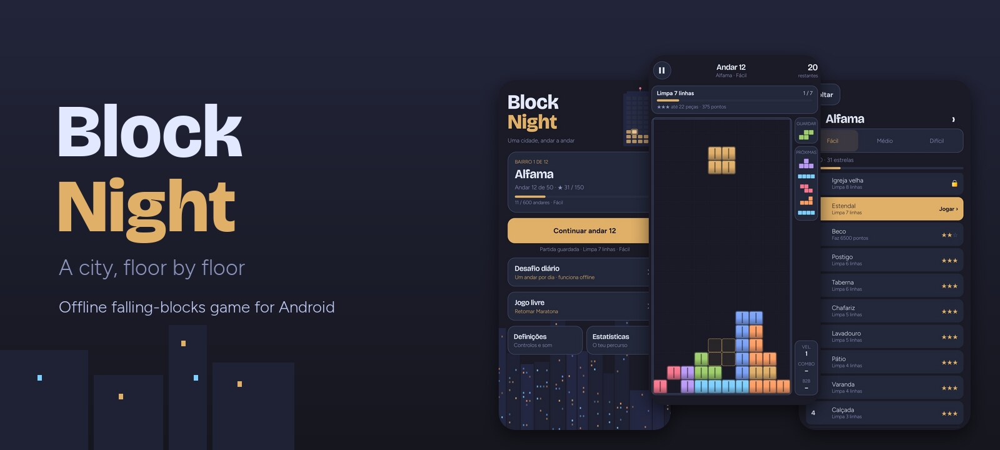

# Block Night

**An offline falling-blocks game for Android: climb 600 floors across 12 night-time districts, in three difficulties, every variant proven clearable.**

[](https://github.com/SyscallBrain/block-night/actions/workflows/ci.yml)
[](LICENSE)


<br>


[Features](#features) · [Screenshots](#screenshots) · [How to play](#how-to-play) · [Build](#building-from-source) · [Architecture](#architecture) · [Contributing](#contributing)

</div>

---

## About

Block Night is a real-time falling-blocks game with a campaign. The city is a skyline of **twelve districts**, from Alfama to Parque das Nações. Each district is a tower of **fifty floors**, and each floor is a level with its own goal: clear lines, light up windows, dig through garbage, score a Quad or chain a combo, all within a piece budget. As you clear floors, the windows of the district light up on the home screen.

Every floor comes in Easy, Medium and Hard, and every one of the **1,800 variants ships with a solution certificate**. An offline solver plays each variant with the same Kotlin engine that runs the game, and the build replays all the certificates. If a floor can no longer be cleared within its budget, the build fails.

A floor always deals the same pieces in the same order, so losing never changes your luck. The game has **no network permission**. There are no ads, no accounts and no analytics. Your progress stays on the device unless you export it.

## Features

| | |
|---|---|
| 🏙️ **Campaign** | 600 floors in 12 districts of 50. Clear a floor to open the next one; one star is enough. Stars reward finishing in fewer pieces. |
| 🎯 **Seven kinds of goals** | Clear *N* lines, score *N* points, make Quads, make T-Spins, reach a combo, light every window, or clear all the garbage. |
| 🧱 **Special cells** | Garbage, concrete that cracks into garbage instead of clearing, lit target windows, garbage that rises every few pieces, and floors without Hold. |
| ⚖️ **Three difficulties** | Easy, Medium and Hard are separately tuned and certified variants with their own speed, piece budget and number of next pieces (5, 3 or 2). Each difficulty keeps its own progress. |
| 📅 **Daily challenge** | One certified floor per day and difficulty, chosen from the device date. No server involved. |
| ♾️ **Free play** | **Marathon** from level 1–10 up to 15, **Sprint 40** against the clock, **Ultra 2:00** for points, and **Zen**, where you never lose. |
| 🕹️ **Modern rules** | SRS rotation with wall kicks, 7-bag randomizer, Hold, ghost piece, lock delay, T-Spins (full and mini), back-to-back, combos and perfect clears. |
| ✋ **Two control schemes** | Touch gestures over the whole play area, or an on-screen pad with adjustable DAS and ARR. Both have a left-handed layout. |
| 🏆 **Progress** | Statistics per difficulty, records for each free mode, and local achievements. |
| 💾 **Your data, your device** | Matches are saved after every piece and resume exactly where you left off. Progress export and import go through the system file picker. |
| 🌍 **Localized** | English by default and Portuguese on Portuguese devices. |

## Screenshots

> The screenshots show the Portuguese interface. On other system languages the game runs in English.

<table>
  <tr>
    <td align="center">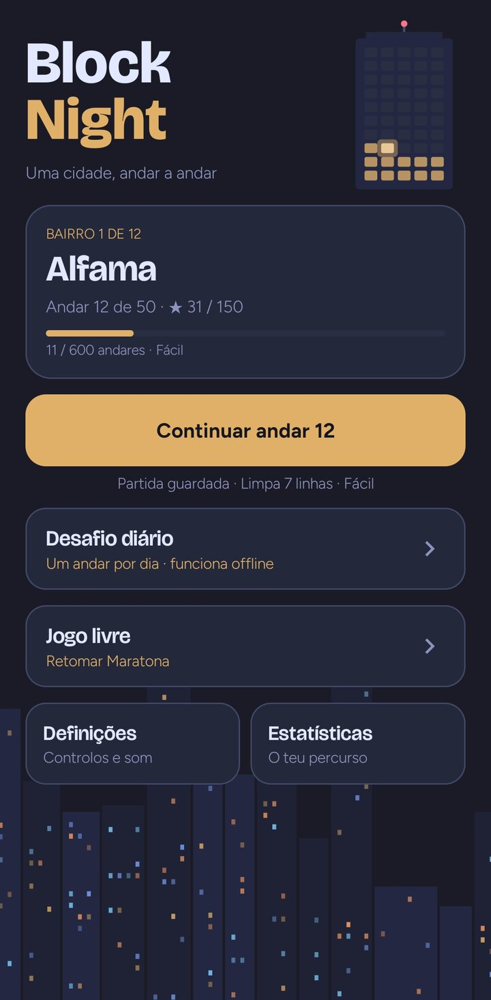<br><sub>Home</sub></td>
    <td align="center">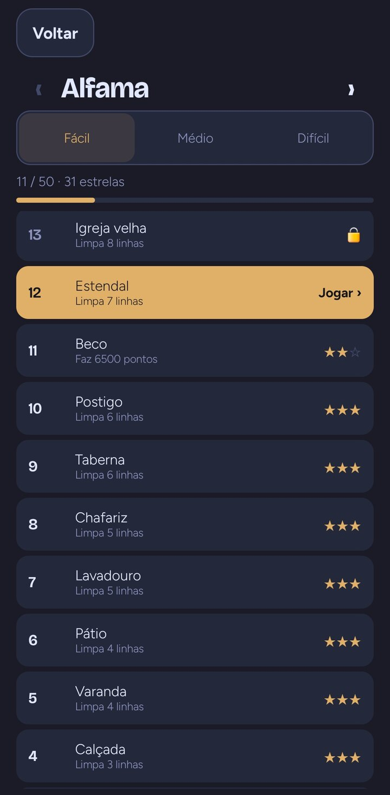<br><sub>District map</sub></td>
    <td align="center">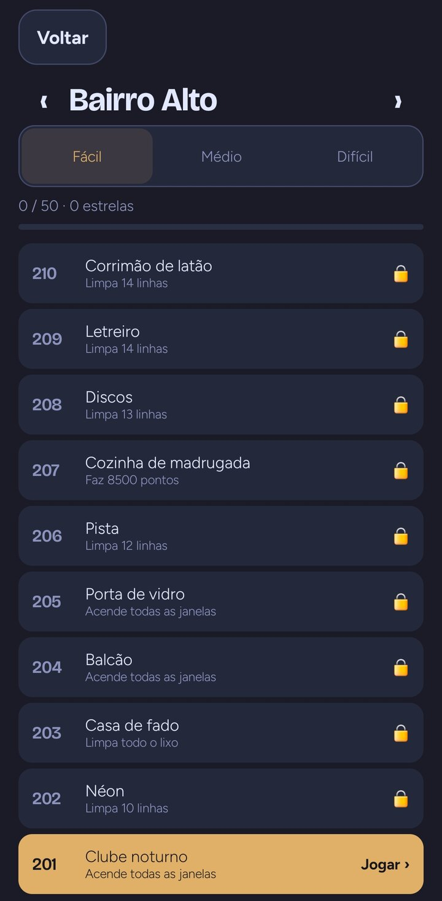<br><sub>Another district</sub></td>
    <td align="center">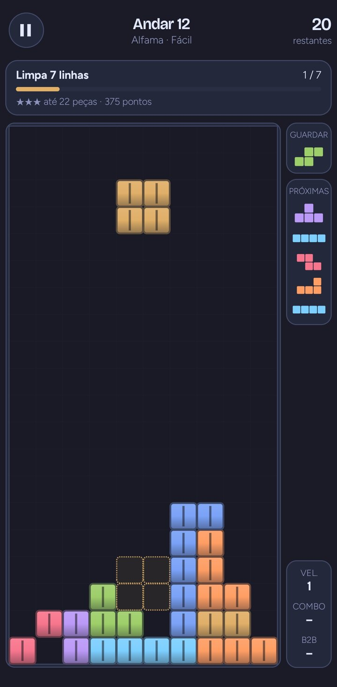<br><sub>Playing a floor</sub></td>
  </tr>
  <tr>
    <td align="center">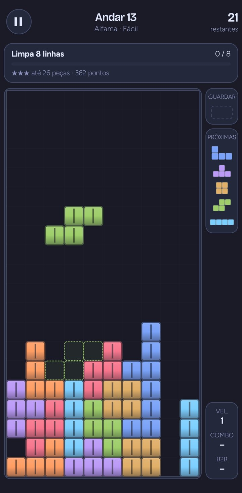<br><sub>Ghost piece and Hold</sub></td>
    <td align="center">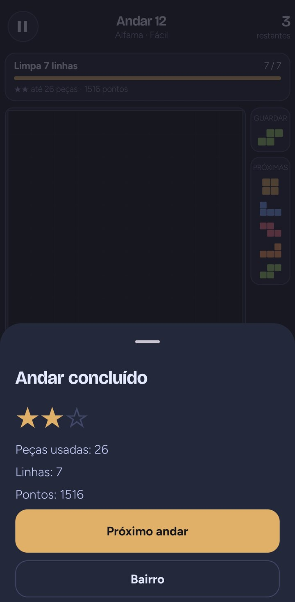<br><sub>Floor cleared</sub></td>
    <td align="center">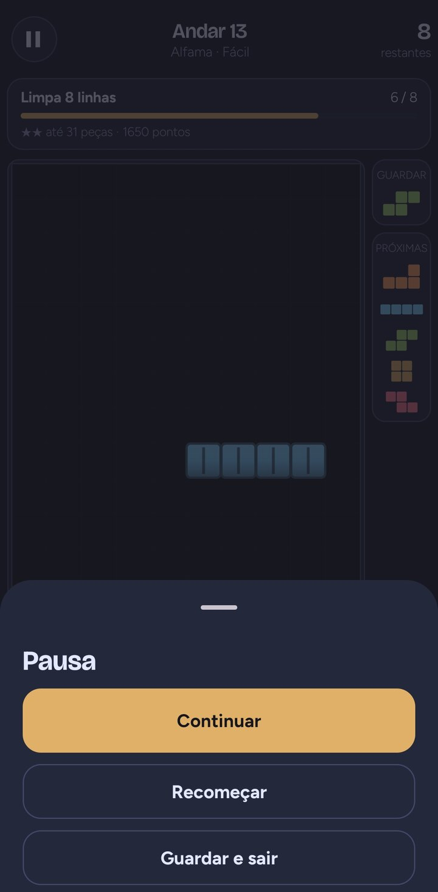<br><sub>Pause</sub></td>
    <td align="center">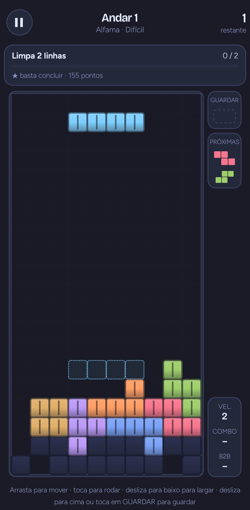<br><sub>Hard floor with garbage</sub></td>
  </tr>
  <tr>
    <td align="center">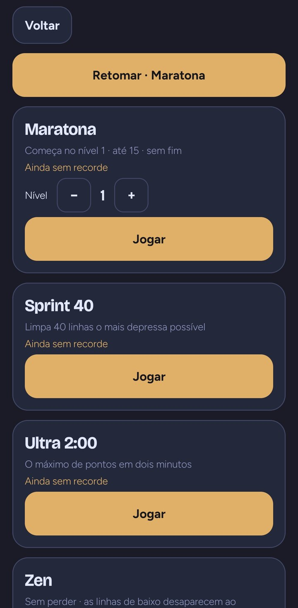<br><sub>Free play</sub></td>
    <td align="center">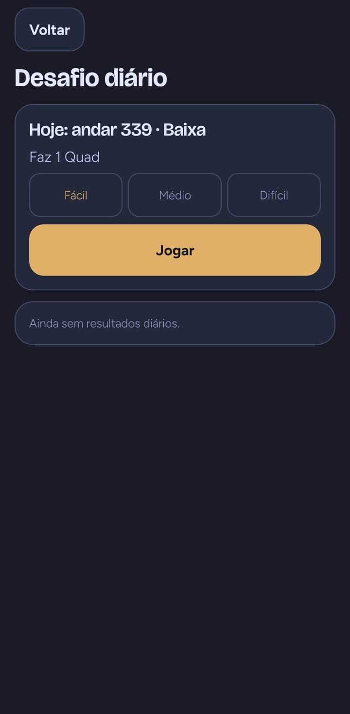<br><sub>Daily challenge</sub></td>
    <td align="center">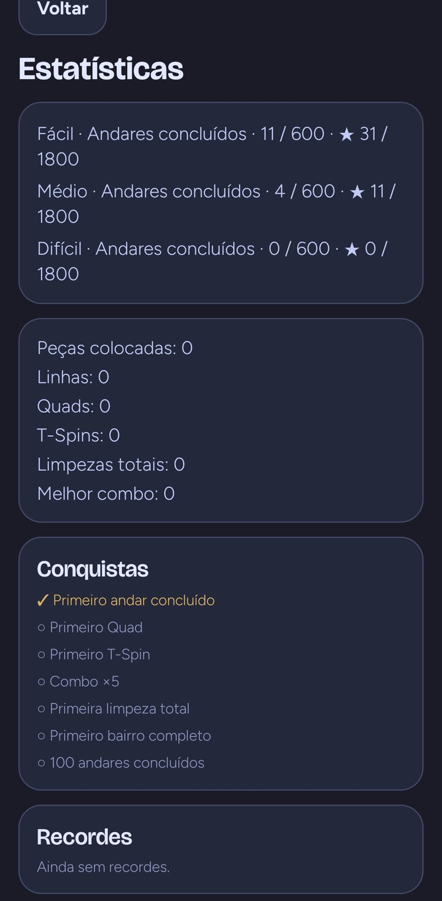<br><sub>Statistics</sub></td>
    <td align="center">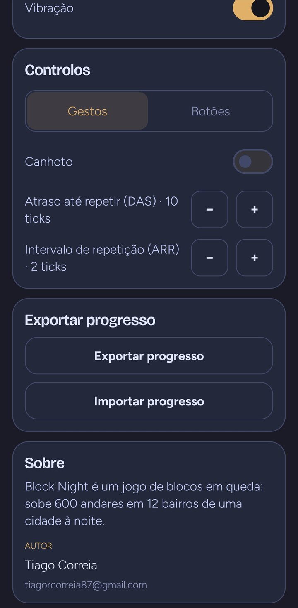<br><sub>Settings</sub></td>
  </tr>
</table>

## How to play

Pieces fall into a well 10 cells wide. Complete a row to clear it. Each floor tells you its goal at the top, and the number in the top right corner is how many pieces you have left. Reach the goal before the pieces run out or the stack reaches the top.

### Controls

| Gesture | Action |
|---|---|
| Drag left or right | Move the piece one column at a time |
| Tap the right half of the board | Rotate clockwise |
| Tap the left half of the board | Rotate counter-clockwise |
| Drag down and hold | Soft drop |
| Quick swipe down | Hard drop |
| Quick swipe up, or tap **HOLD** | Hold the piece (once per piece) |

The whole play area takes gestures, so you can drag below or beside the board without covering it with your thumb. If you prefer buttons, switch **Settings → Controls** to *Buttons* for a pad with ← → ↓ ⟲ ⟳, Hold and Drop. The pad and the side column can be mirrored for left-handed play.

Back or the pause button pauses the match, and so does leaving the app. Resuming always starts with a 3-2-1 countdown.

### Stars and scoring

You earn **1 star** for clearing a floor, and **2 or 3 stars** for clearing it within the floor's piece targets. The objective card always shows the best rating still within reach.

| Clear | Points × level |
|---|---|
| Single · Double · Triple · Quad | 100 · 300 · 500 · 800 |
| T-Spin · Single · Double · Triple | 400 · 800 · 1,200 · 1,600 |
| T-Spin Mini · Single · Double | 100 · 200 · 400 |
| Perfect clear (1–4 lines) | 800 · 1,200 · 1,800 · 2,000 |

Back-to-back Quads and T-Spins are worth ×1.5. Each consecutive clear adds a combo bonus of 50 × combo × level. Lighting a target window is worth 150 and cracking concrete 50 per cell.

## Building from source

There is no signed release yet. To play, build the debug APK.

### Requirements

| Tool | Version |
|---|---|
| JDK | 17 or newer (the project is built with JDK 21) |
| Android SDK | Platform `android-37.2`, build tools 37 |
| Gradle | Wrapper included (9.8.0) |
| Python 3 | Only for the optional scripts in `tools/` |

No emulator is needed. The game logic is tested on the JVM.

### Build and install

```bash
git clone https://github.com/SyscallBrain/block-night.git
cd block-night

export JAVA_HOME=/path/to/jdk-21          # any JDK 17+
export ANDROID_HOME=/path/to/android-sdk  # or create local.properties with sdk.dir=...

./gradlew :app:assembleDebug
adb install app/build/outputs/apk/debug/app-debug.apk
```

Every build checks the floor catalog first. It validates the 600 floors and replays all 1,800 certificates before packaging them, so the first build takes a little longer. Later builds reuse the result until something in `content/` changes.

### Full verification

```bash
bash tools/verify.sh
```

This runs the unit tests of all three modules, strict catalog validation, certificate replay, Android lint and the debug APK build. It reports the real exit code of each step and writes the logs to `logs/`.

## Architecture

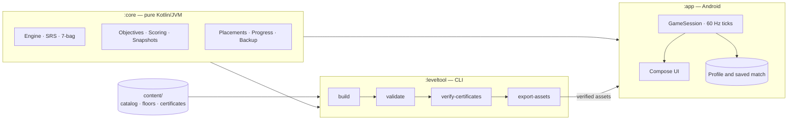

| Module | Role |
|---|---|
| [`core/`](core) | Deterministic rules engine with no Android dependencies: SRS rotation and kicks, a seeded 7-bag randomizer, gravity, lock delay, T-Spin detection, scoring, objectives, special cells, snapshots, progress reducers and backup parsing. |
| [`leveltool/`](leveltool) | Content CLI that uses the same engine to generate floors from structural families, solve them with a beam search, certify, rebalance, report and export the packaged assets. |
| [`app/`](app) | Jetpack Compose UI, the real-time `GameSession`, gesture and button input, atomic saves, sound and haptics. |
| [`content/`](content) | The floor catalog: 600 floor files and 1,800 certificates. |
| [`tools/`](tools) | Verification, sound generation and the floor-title script. |

Some design choices:

- **One engine everywhere.** The solver, the certificate checker and the game all run the same `:core` code, so a certified solution is replayed exactly as a player would play it.
- **Fixed 60 Hz ticks.** The engine advances in discrete ticks with explicit commands. Frame rate never changes gravity, lock delay or scoring, and a match can be saved and restored exactly.
- **The phone never solves.** All the search happens at build time; the APK only ships floors that passed validation and replay.
- **Crash-safe progress.** The match is saved after every locked piece with atomic writes. An unreadable profile is kept aside and never overwritten silently.

## Floor content

Floors live in `content/` as plain JSON, one file per floor with its three variants, and one certificate per variant.

```bash
./gradlew :leveltool:validateCatalog       # structure, rules and counts
./gradlew :leveltool:verifyCertificates    # replay all 1,800 certificates
./gradlew :leveltool:run --args='report --root content --output report.md'
```

`build` generates and certifies floors from structural families, for a whole district or a range of floors. Run `./gradlew :leveltool:run` without arguments to see every command and option.

## Privacy

Block Night declares a single permission, `VIBRATE`. It has no internet access, collects no data and contains no third-party SDKs. Progress is stored in the app's private storage and is excluded from cloud backups. Exporting or importing progress happens only when you choose to, through the Android system picker.

## Contributing

Bug reports, translations and pull requests are welcome. Please read [CONTRIBUTING.md](CONTRIBUTING.md) first. It covers the development setup, coding conventions and the rules for changing floor content.

## Credits

- Design and development: **Tiago Correia**
- Fonts: [Figtree](https://github.com/erikdkennedy/figtree) and [Bricolage Grotesque](https://github.com/ateliertriay/bricolage), both under the SIL Open Font License (texts in [`app/src/main/assets/licenses`](app/src/main/assets/licenses)).
- Sound effects: original tones synthesized by [`tools/generate_sounds.py`](tools/generate_sounds.py).

Block Night is an independent project and is not affiliated with or endorsed by The Tetris Company.

## License

Released under the [MIT License](LICENSE). Copyright © 2026 Tiago Correia.
